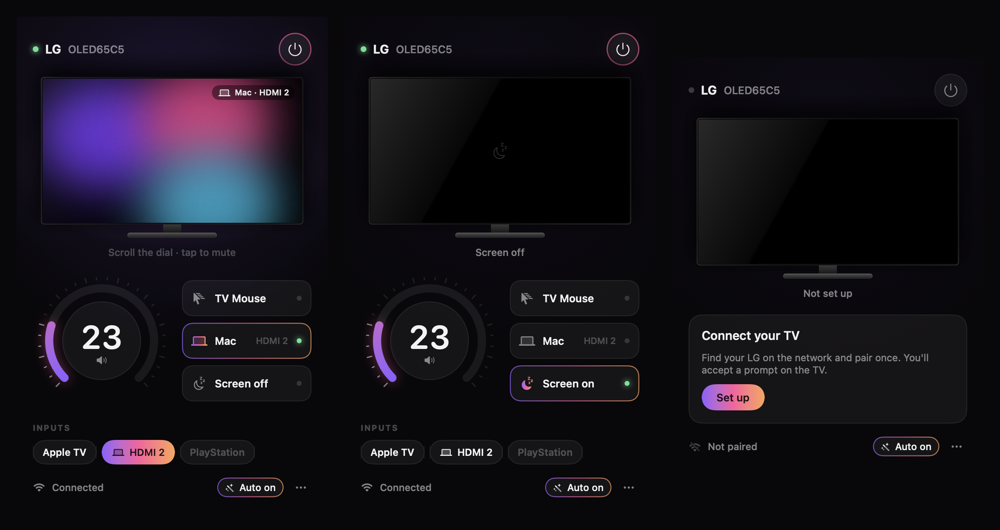

<h1 align="center">TV Companion</h1>

<p align="center">
  A macOS menu bar app for LG webOS TVs.<br>
  Power, volume and inputs in one click, and your trackpad becomes the TV's remote.
</p>

<p align="center">
  
  
  
  <a href="LICENSE"></a>
</p>

<p align="center">
  
</p>

## Features

- **TV Mouse.** Press <kbd>⌃⌥M</kbd> and the Mac's trackpad drives the TV's pointer, the same one the Magic Remote uses. Click, scroll, right-click for Back, arrow keys and Return to navigate, Space to play or pause, and Esc to give the trackpad back.
- **Volume dial.** Two-finger scroll or drag over the dial to set the volume, and tap it to mute. The mini TV shows the same volume overlay as the real one.
- **One-click power.** Wake-on-LAN turns the TV on and switches it to the Mac's HDMI input. You can also turn the TV off, or turn off only the screen while audio keeps playing.
- **Inputs.** Switch HDMI inputs from the menu bar. The app shows which input is active, and which one the Mac is on.
- **Automations (optional):**
  - Mac wakes or unlocks → the TV turns on and switches to the Mac.
  - Display sleeps or the Mac locks → the TV, or only its screen, turns off.
  - Mac sleeps → the TV turns off.
  - By default, the app turns the TV off only when it's showing the Mac, and turns it back on only if the app was what turned it off.

Everything runs locally between your Mac and the TV. There's no cloud, no account and no telemetry.

## Requirements

- macOS 14 Sonoma or later
- An LG TV with webOS. Development and testing were on a 2025 C5 (webOS 25). Other webOS TVs use the same protocol and should work, but they're untested.
- The Mac and the TV on the same local network

## Install

Prebuilt releases aren't available yet, so build from source:

```sh
brew install xcodegen
git clone https://github.com/buraksakalli/tv-companion-.git
cd tv-companion-
make install      # builds Release and copies it to ~/Applications
```

`make run` builds and opens the app without installing it. `make test` runs the unit tests.

## Setup

1. **On the TV:** go to **Settings → General → TV On With Mobile → Turn on via Wi-Fi** and turn it on. This is required for Wake-on-LAN. On older webOS versions the menu is called *TV Management* or *Mobile TV On*.
2. Recommended: give the TV a fixed IP (a DHCP reservation) in your router.
3. Click the menu bar icon → **Set up** → **Search**, or type the TV's IP address → **Pair** → accept the prompt on the TV.
4. Choose which HDMI input your Mac is connected to.
5. When macOS asks to *find devices on your local network*, allow it.

## How it works

| What | How |
| --- | --- |
| Commands (power, volume, inputs) | The TV's local webOS "second screen" API (SSAP) over a secure WebSocket on port 3001 |
| TV Mouse | AppKit captures trackpad deltas through a local `NSEvent` monitor on the app's own panel. CoreGraphics freezes and hides the cursor. Movement is coalesced at 60 Hz and streamed to the TV's pointer input socket. |
| Global shortcut | Carbon `RegisterEventHotKey`. No Accessibility or Input Monitoring permission is needed. |
| Turning the TV on | A Wake-on-LAN magic packet. The TV's MAC address is learned automatically. |
| Discovery | SSDP (`urn:lge-com:service:webos-second-screen:1`) |
| Sleep and wake automations | NSWorkspace notifications and IOKit power notifications. System sleep is held for at most 5 s so the power-off command can reach the TV. |

The app is plain Swift 6, SwiftUI and AppKit, with no third-party dependencies.

## Security and privacy

- The app only uses `wss://` on port 3001 and never the plaintext `ws://` port 3000.
- The TV uses a self-signed certificate. Its SHA-256 fingerprint is **pinned at first pairing** (trust on first use), and any other certificate is rejected after that. If the TV is reset or replaced, use **Forget TV** and pair again.
- The pairing key is stored in the macOS Keychain with *this device only* access and is never logged.
- The app requests a small set of webOS permissions: power, screen, inputs, audio, app status, toasts and the pointer.
- The only network traffic goes to your TV.

See [SECURITY.md](SECURITY.md) for how to report a vulnerability.

## Troubleshooting

**"The Internet connection appears to be offline" or "Network is down" when you pair.**
macOS Local Network privacy is blocking the app. Open **System Settings → Privacy & Security → Local Network** and turn on TV Companion. If it already looks on, turn it off and on again. Ad-hoc-signed builds get a new identity on every build, so macOS may forget this permission after a rebuild. To avoid that, sign with your own team (see below).

**The TV doesn't turn on.**
Check that *Turn on via Wi-Fi* is enabled. Then turn the TV on once from the remote while the app is running, so it can learn the TV's MAC address.

**TV Mouse says to re-pair.**
Older pairings didn't include the pointer permission. Use **Settings → Re-pair**.

## Development

The Xcode project is generated with [XcodeGen](https://github.com/yonaskolb/XcodeGen) from `project.yml`, and isn't committed.

```sh
make project   # generate TVCompanion.xcodeproj
open TVCompanion.xcodeproj
```

**Code signing.** Builds are ad-hoc signed by default, so no Apple Developer account is needed. For a stable signature, copy `Config/Local.xcconfig.example` to `Config/Local.xcconfig`, which is git-ignored, and set your team ID. A stable signature also means the Local Network permission survives rebuilds.

```
Sources/TVCompanion/
├── Protocol/   SSAP client, JSON, certificate pinning, pointer socket
├── Network/    Wake-on-LAN, SSDP discovery
├── System/     Keychain, sleep/wake events, hot key, TV Mouse
└── Views/      Menu bar UI, settings
Tests/          Swift Testing unit tests
```

Debug builds have two extra flags:

- `--snapshot <dir>` renders the menu in each state to PNG files. This is how the screenshots above were made.
- `--probe` writes a connection diagnostic to `~/Library/Logs/TVCompanion/probe.log`.

Contributions are welcome. See [CONTRIBUTING.md](CONTRIBUTING.md).

## Acknowledgements

The protocol details follow Home Assistant's [aiowebostv](https://github.com/home-assistant-libs/aiowebostv), the most complete open-source reference for the webOS second-screen API.

## Disclaimer

TV Companion is an independent project. It is not affiliated with, endorsed by or sponsored by LG Electronics. LG and webOS are trademarks of LG Electronics Inc.

## License

[MIT](LICENSE)
